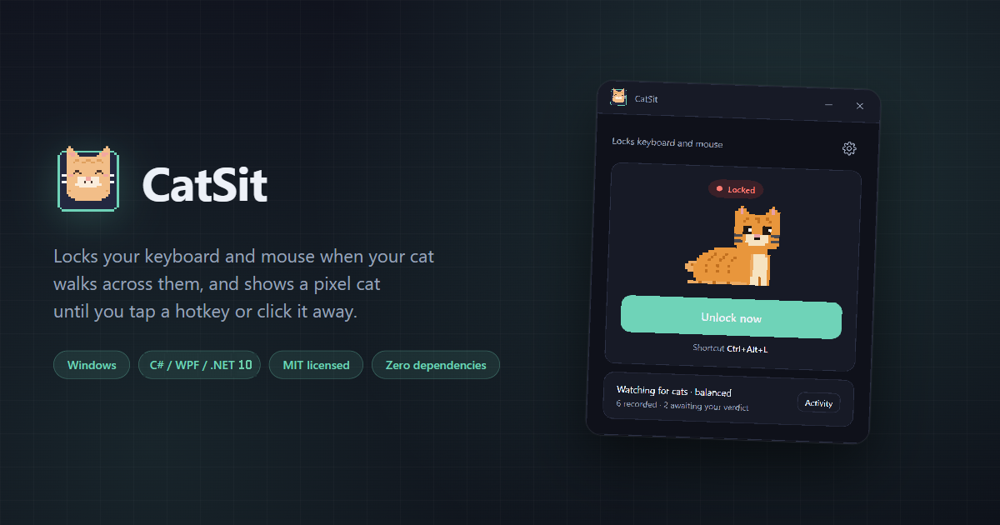
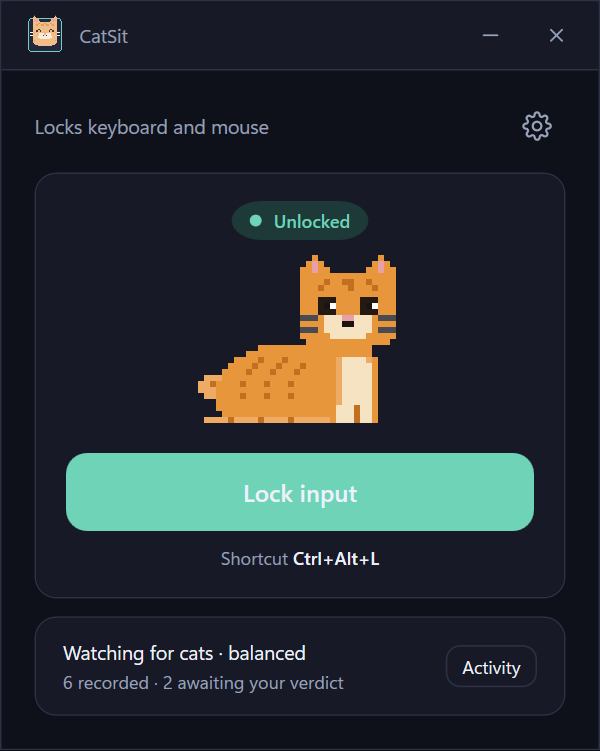
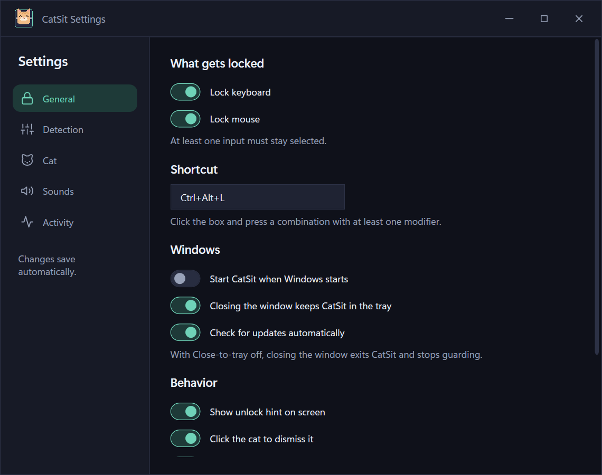
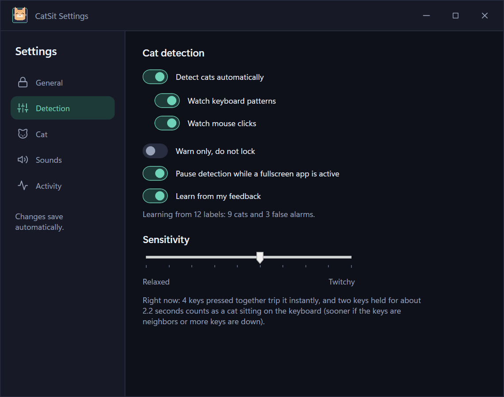
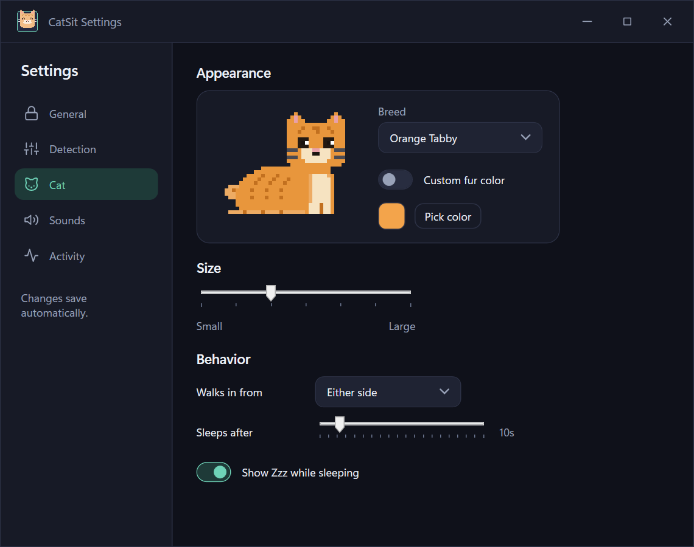
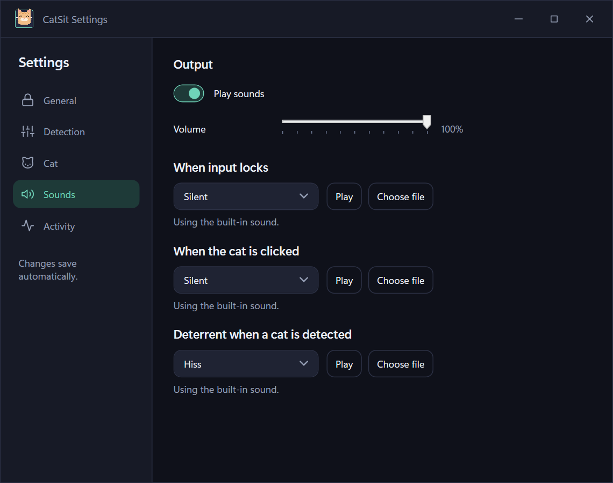
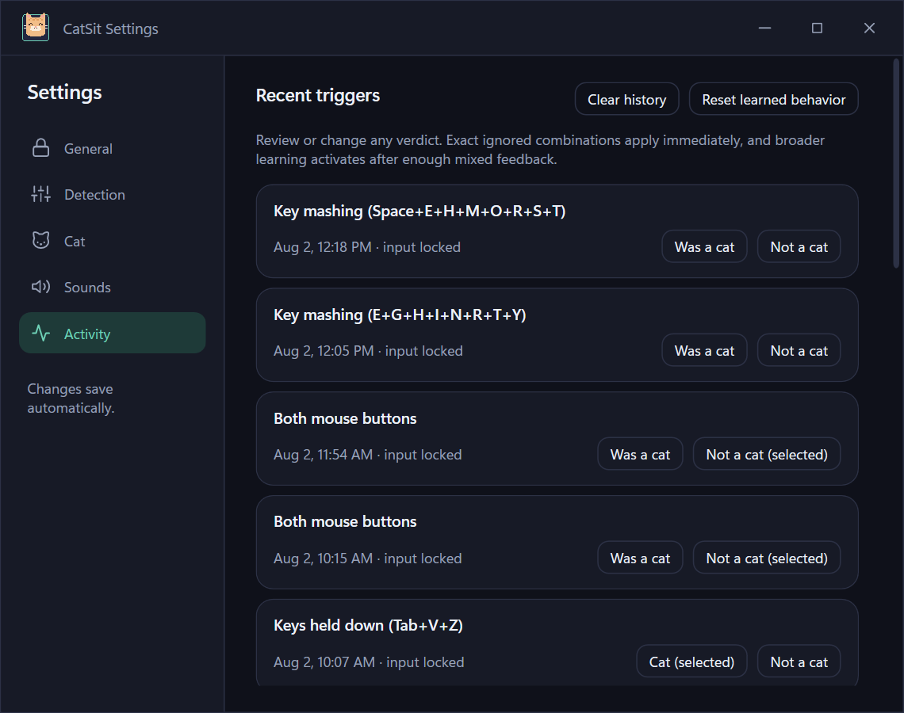

<p align="center">
  
</p>

<h1 align="center">CatSit</h1>

<p align="center">
  Locks your keyboard and mouse when your cat walks across them, and shows an animated<br>
  pixel-art cat until you tap a hotkey or click it away.
</p>

<p align="center">
  
  
  
  
</p>


## What it is

CatSit watches your keyboard and mouse for the kind of input a cat produces (paws mashing keys, sitting on the keyboard, batting the mouse) and locks input the moment it's confident, showing an animated cat on top of everything until you either press a hotkey or click the cat to send it away. It's a Windows desktop app, not a browser extension or background service.

## Quick start

Runs on 64-bit Windows 10 and 11. The exe is self-contained, so there is no signup and no .NET runtime prompt.

1. Grab the latest installer or portable exe from the [Releases page](https://github.com/glvckoma/CatSit/releases).
2. Run it. CatSit starts in the tray.
3. Tell your cat to have at it.

The exe is not code signed, so Windows SmartScreen may show a blue "Windows protected your PC" box on first run. Click **More info** then **Run anyway**. Code signing certificates cost real money and this is a free side project. If you would rather not trust a stranger's binary, the build steps below produce the same thing.

## Getting unlocked

There are three ways out of a lock:

- Press the hotkey. It is `Ctrl+Alt+L` out of the box and you can change it.
- Click the cat. This works unless you turn click-to-dismiss off.
- Wait for the auto-unlock timer, which is off by default and lives in Settings > General.

Ctrl+Alt+Delete also works, because Windows reserves it and no app can block it.

## Build from source

Requires the .NET 10 SDK.

```bash
git clone https://github.com/glvckoma/CatSit.git
cd CatSit
dotnet build CatSit.sln -c Release
dotnet test tests/CatSit.Core.Tests
```

Publish a self-contained single-file build yourself:

```bash
dotnet publish src/CatSit/CatSit.csproj -c Release -r win-x64 --self-contained true -p:PublishSingleFile=true -p:IncludeNativeLibrariesForSelfExtract=true
```

Or build the installer (see [installer/README.md](installer/README.md)).

## The app window

The tray window is the whole app. You can lock and unlock by hand, see how many triggers are waiting for your verdict, and jump into settings.

| Unlocked | Locked |
|---|---|
|  |  |

## How detection works

CatSit combines these built-in signals, all scaled by a single 1-10 sensitivity slider:

- **Paw cluster:** several adjacent keys pressed at once
- **Mash burst:** a rapid burst of distinct keys in a short window with high adjacency
- **Sustained hold:** 2+ keys held down past a duration (shorter if more keys, or if they're neighbors)
- **Click burst:** rapid mouse clicks per second
- **Both buttons held:** left and right mouse held together (higher sensitivity only)

## Adaptive learning

CatSit keeps a rolling log of the last 50 triggers, and every verdict stays editable. Exact keyboard combinations marked "Not a cat" are ignored immediately. After at least six labels, including two cats and two false alarms, a small built-in classifier can suppress similar patterns. Suppressed events remain visible in Activity so you can correct them. The model is local, built from scratch, and uses no ML framework.

## Customize your cat

Seven breed presets are included: Orange Tabby, Gray Tabby, Tuxedo, Siamese, Black, White, and Calico. A custom fur-tint mode derives the stripes and belly automatically from one selected color.

## Sound

All audio is synthesized at runtime; no `.wav` files are shipped. Lock sound (Chime / Beep / Thud / Alarm, or silent), cat sound (Meow / Chirp / Trill, or silent), and deterrent sound (Hiss / Shake, or silent) each also support pointing at your own custom `.wav` file, plus a volume slider and an in-app preview button.

## Settings tour

| General | Detection |
|---|---|
|  |  |
| Lock keyboard/mouse, hotkey, hidden Windows startup, close-to-tray, manual or automatic update checks, unlock hint, auto-unlock timer, and restore defaults. | Separate keyboard and mouse monitoring, warn-only mode, pause in fullscreen, the learning toggle, and the sensitivity slider. |

| Cat | Sounds |
|---|---|
|  |  |
| Breed picker, custom fur color, size, entry edge, sleep timer. | Volume, and a picker/preview/file-chooser for each of the three sound categories. |

**Activity** shows triggered and learned-suppressed events with editable "Was a cat" and "Not a cat" feedback. Clear history removes visible rows without erasing learning. Reset learned behavior clears learned samples and ignored combinations, while keeping recent triggers and marking them unreviewed:



## Updates

CatSit checks GitHub Releases once per launch unless you turn automatic checks off. You can also check manually under Settings > General. CatSit always asks before downloading anything: Download now, Remind me later, or Skip this version. Nothing installs itself without you saying so.

## What it does to your machine

To notice a cat, CatSit has to watch input, so it installs global low-level keyboard and mouse hooks. That is the same Windows mechanism a keylogger uses, and it is fair to be wary of it. Here is exactly what CatSit does with it. Key and button events are turned into counts and timings, such as how many keys are down and whether they sit next to each other on the keyboard. Nothing is typed anywhere, stored as text, or sent off the machine. The Activity list shows key names only so you can review your own triggers. All of it is in [src/CatSit.Core/Detection](src/CatSit.Core/Detection) and [src/CatSit/Interop](src/CatSit/Interop) if you want to read it yourself.

Your settings, trigger history, and learned samples live in `%APPDATA%\CatSit`. The uninstaller asks whether to keep or delete that folder. The only registry write is the Start-with-Windows entry, and only when you turn it on.

## Why no external assets and no telemetry

Zero third-party NuGet packages in the shipped app or its core library. Every pixel of the cat and the app icon is hand-authored as C# string-grid data, rasterized at runtime, not loaded from image files. Every sound is synthesized at runtime, not a bundled `.wav`. The app makes no network calls except the optional update check above, and reports nothing anywhere.

## Contributing

Contributions welcome, see [CONTRIBUTING.md](CONTRIBUTING.md).

## License

MIT, see [LICENSE](LICENSE).

Made by [glvckoma](https://github.com/glvckoma).
